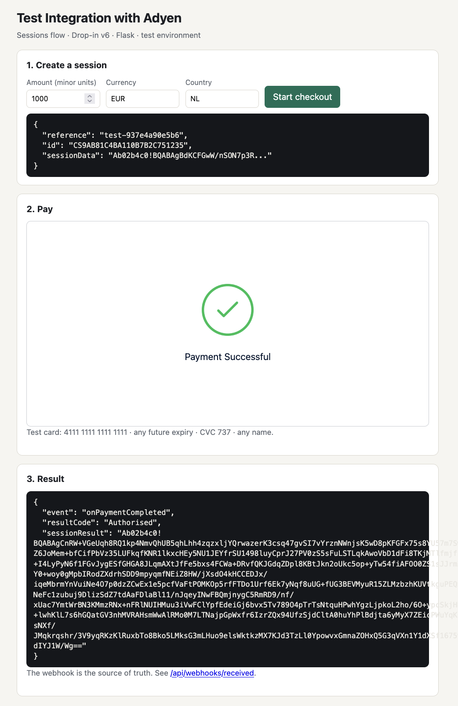

# Test Integration with Adyen

A minimal, end-to-end Adyen Checkout integration you can clone and run in ten minutes:
Flask on the server, Adyen's Drop-in v6 in the browser, the Sessions flow in between,
and an HMAC-verified webhook receiver so the result is confirmed by Adyen, not by the browser.



*First run against a live Adyen test account, 2026-10-19: session created server-side, Drop-in rendered from the CDN, test card authorised.*

Built as a developer-experience exercise: every step a first-time integrator hits is in
[FRICTION_LOG.md](FRICTION_LOG.md). The code is deliberately plain `requests` + stdlib `hmac`
so the request and response shapes stay visible.

```
browser ──POST /api/sessions──▶ Flask ──POST /v71/sessions──▶ Adyen
browser ◀── { id, sessionData } ── Flask
Drop-in renders ▶ shopper pays ▶ Adyen ──webhook──▶ Flask /api/webhooks/notifications (HMAC checked)
```

## What's in it

| Path | What it does |
| --- | --- |
| `app.py` | Flask app: `/` checkout page, `POST /api/sessions`, `POST /api/webhooks/notifications`, `GET /api/webhooks/received`, `/redirect` |
| `adyen_client.py` | Builds and sends the `/sessions` request |
| `webhook.py` | Standard-webhook HMAC-SHA256 verification (matches Adyen's published test vector) |
| `static/checkout.js` | Loads Drop-in v6 from the CDN, creates the session, mounts Drop-in, reports the result |
| `static/redirect.js` | Finishes redirect payment methods (iDEAL, 3DS) via `submitDetails` |
| `tests/` | 15 tests: HMAC vector and tamper cases, session request shape, webhook endpoint behavior |

## Run it

1. **Get test credentials** in [Customer Area (test)](https://ca-test.adyen.com):
   `Developers > API credentials` for the API key and client key; your merchant account code from the top bar;
   `Developers > Webhooks > Standard webhook` for the HMAC key (generate one and copy the hex string).
2. **Configure**
   ```bash
   cp .env.example .env   # fill in the four ADYEN_* values
   pip install -r requirements.txt
   ```
3. **Start**
   ```bash
   python app.py          # http://localhost:8080
   ```
4. **Pay** with the test card `4111 1111 1111 1111`, any future expiry, CVC `737`. Expect `resultCode: Authorised`.
5. **Webhook** (optional but recommended). Expose port 8080 with a tunnel and point the Standard webhook at
   `https://<your-tunnel>/api/webhooks/notifications`:
   ```bash
   ngrok http 8080        # or: cloudflared tunnel --url http://localhost:8080
   ```
   Accepted notifications show at `http://localhost:8080/api/webhooks/received`.

## Test

```bash
python -m pytest -q
```

## Notes

- Amounts are in minor units: `1000` with `EUR` is EUR 10.00.
- `RETURN_URL` must be reachable by the shopper's browser, not by Adyen; `localhost` is fine for cards.
  Redirect methods (iDEAL) need a tunnel URL here too.
- The webhook handler returns HTTP 200 even for items that fail HMAC (they are logged and dropped),
  so Adyen does not retry a tampered item forever. Missing HMAC key returns 500 so misconfiguration is loud.
- Drop-in is loaded from Adyen's CDN at a pinned version (6.46.0). For production, add the
  `integrity` attributes from the release notes and self-host or pin per Adyen's guidance.
- Client key, API key, and HMAC key are read from `.env`; nothing is committed. `.env` is git-ignored.

## Status

See [STATUS.md](STATUS.md) for what has and hasn't been verified against a live test account.
